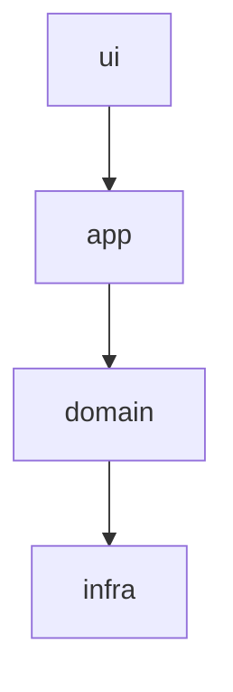

# Architecture Spine — {name}

<!-- Keep only the sections this spine needs; cut the rest (no empty headers). A small intent may be just paradigm +
a few ADs + conventions. Record decisions, not rationale. Carry shape in diagrams; prose only where it must. Delete
these comments before finishing. -->

## Design Paradigm

{Name the pattern (a known one loads a whole model for free) and map its layers to namespaces/directories. The
smallest, most durable thing here.}

## Inherited Invariants

<!-- Only when this spine inherits a higher-altitude parent. Read-only, never renumbered. A local decision that
contradicts one is a conflict to surface, not an override. Cut otherwise. -->

| Inherited | From parent | Binds here |
| --- | --- | --- |
| {AD-id / convention} | {parent spine} | {what it constrains in this scope} |

## Invariants & Rules

<!-- The durable heart: calls a future builder cannot read off compliant code. One block per decision: stable
ascending id (never reused or renumbered), Binds, Prevents, Rule. Tag [ADOPTED] when the user or existing reality
settled it. -->

### AD-1 — {decision}

- **Binds:** {capability / unit ids / areas, or `all`}
- **Prevents:** {the divergence this stops}
- **Rule:** {the constraint downstream must follow}

## Dependency Direction

<!-- This IS a rule. Author it as valid mermaid, never an empty graph. -->

## Consistency Conventions

<!-- Defaults that bind where independent builders would drift. Cut rows that do not apply. -->

| Concern | Convention |
| --- | --- |
| Naming | {…} |
| Errors | {…} |
| State | {…} |
| Data ownership | {…} |

## Deferred

<!-- Decisions deliberately left open, and what will force them. -->
