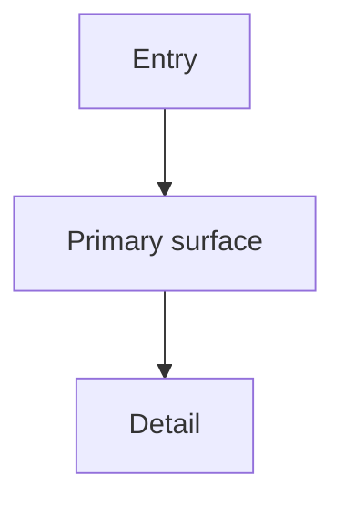

# Experience: {Product Name}

## Foundation

{Form factor and the UI system in use, if any. `DESIGN.md` is the visual-identity reference.}

## Information Architecture

{Screens, hierarchy, navigation model, and how the user moves between them.}

## Voice and Tone

{Microcopy rules: labels, errors, empty states, confirmations.}

## Component Patterns

| Component | Behavior | Triggers |
| --- | --- | --- |

## State Patterns

| Surface | Loading | Empty | Error | Partial | Offline | Success |
| --- | --- | --- | --- | --- | --- | --- |

## Interaction Primitives

{Gestures, keyboard model, focus order, motion rules, feedback timing.}

## Accessibility Floor

- Focus: …
- Keyboard: …
- Screen reader: …
- Reduced motion: …
- Contrast: see `DESIGN.md`

## Key Flows

### KF-1. {Named protagonist does the thing}

- **Entry state:** …
- **Path:** …
- **Climax:** … (and how they know value landed)
- **Resolution:** …
- **Edge case:** …

## Open Questions

<!-- Optional. Omit if empty. -->
